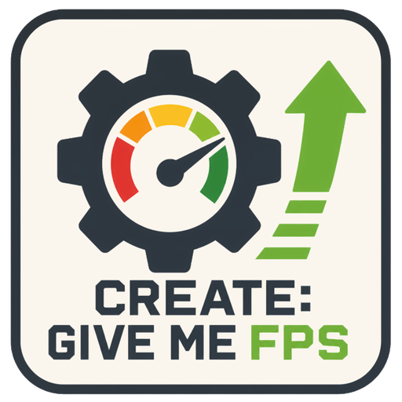

# Create: Give Me FPS

[Русский](README_RU.md) · [Releases](https://github.com/Grovymon/Create-Give-Me-FPS/releases) · [Audit and validation](docs/AUDIT_REPORT.md)

<p align="center"></p>

GMF is a **client-side visual performance layer and diagnostics tool for Create factories**.
It never modifies machine ticks, RPM, stress, inventories, recipes, fluids, belt transport,
redstone, trains, contraption physics or saved worlds. Turning a visual off does not stop the factory.

## Controls

Open the configuration from Minecraft's Mods menu. Profiles: Potato, Low, Medium,
Above Average, High, Ultra, or Custom. Controls affect supported rendering paths, not every addon renderer.

- **Mechanisms:** animation-group switches; full-animation radius (0–32 blocks);
  Full/Reduced/Static distant behavior; simplified animation FPS and client visual tick divisor.
- **Pause Off-Screen Animations:** separate from hiding behind walls. Uses camera frustum,
  cached padded bounds and a three-frame grace period. Disabled by default pending the in-game
  compatibility matrix. Unknown bounds stay visible; camera re-entry resumes without waiting for a reduced-update bucket.
- **Hide occluded mechanisms:** Entity Culling visibility drives reversible Flywheel visual
  removal/restoration. Nowheel takes ownership when installed. Moving contraptions are not wall-culled.
- **Create addons:** Mechanisms → Create Addons → installed addon → observed compatible
  block-entity types. Discovery uses registry/type identity and Create inheritance, with no addon hard dependencies.
  Custom renderers and undiscovered types need further adapters/testing.
- **Belts:** hide transported stacks entirely or reduce their shadows independently.
  Ordinary dropped items, including items near crushers or launched by ejectors, are never hidden by proximity.
- **Particles:** Full/Reduced/Off plus steam/smoke, sparks, item-break and fluid categories.
  Global filtering accepts only registered Create particles. Explicit client Create fluid and burner paths
  can suppress their vanilla effects. Other vanilla particles are not globally filtered.
- **Flywheel:** Default, Indirect, Instancing, Off. Accelerated Rendering is an optional
  CreateBetterFPS-derived path requiring Sodium and Iris. These two renderer choices are applied at launch:
  a red restart warning disappears if the saved settings return to the active launch values.
- **Toggle Performance Mode:** assign this separate, initially unbound key in Minecraft Controls.
  Current visual settings → Potato → exact previous visual snapshot, including Custom values.
  Temporary Potato settings are not accidentally persisted by saving unrelated report preferences.
- **Adaptive recommendations:** opt-in sustained-FPS proposals with hysteresis/cooldown.
  They never change settings automatically.

## Diagnostics and experiments

Developer Mode provides local recording, snapshot reports and Stop-and-save in
`logs/GMF/<timestamp>/`. No telemetry or automatic upload.

Measured frame intervals include average FPS, 1% low (enough samples required), p95/p99,
maximum frame time, heap and GC. Integrated/server-process MSPT is available where collected;
remote MSPT is unavailable. Scene census is **estimated**, bottleneck attribution **inferred**.

Reports also contain observed Create visual populations, off-screen/occluded observations,
Flywheel block-entity visual count, skipped/resumed animation opportunities, addon counts,
transported-item render calls and suppressed particle/effect requests. Counts are not timings;
a rejected FluidFX batch is not a measured count of individual particles.

Diagnostics opens multiple explicit recommendations with current/proposed values, visual impact,
confidence and evidence. Six runtime A/B targets are selectable: shadows, occlusion, off-screen
pause, distant animations, transported items and particles. Backend/accelerated-render experiments
require separate restarted runs; GMF does not fabricate a live A/B result for them.

## Requirements and installation

Minecraft **1.21.1**, Java **21**, NeoForge **21.1.x**, Create **6.0.10** and Flywheel **1.0.6**.
Entity Culling is required **on the client** by loader metadata. Servers do not need GMF.
See [Compatibility](docs/COMPATIBILITY.md) for exactly what has and has not been tested.

Download the matching NeoForge JAR from [Releases](https://github.com/Grovymon/Create-Give-Me-FPS/releases),
place it in the instance's `mods`, and remove duplicate GMF versions.

## Development and limits

```powershell
.\gradlew.bat clean test build
.\gradlew.bat runClient
```

Artifacts: `build/libs/`. The development runtime selects the NeoForge Entity Culling artifact
by its unambiguous Modrinth version ID; it is not bundled into GMF.
[Architecture](docs/ARCHITECTURE.md) · [Profiler](docs/PROFILER.md) ·
[Benchmark](docs/BENCHMARK.md) · [Deferred work](docs/FUTURE_WORK.md).

No promised FPS percentage, per-machine GPU timings, blanket addon compatibility, item-model
batching, dimension overrides, reduced terrain textures or contraption wall culling.
Compilation and startup are not equivalent to the in-game restoration/shader test matrix.

## Licence and credits

MIT: [LICENSE](LICENSE). Adapted code retains MIT attribution for
[CreateBetterFPS](https://github.com/MoePus/CreateBetterFPS) by MoePus and
[Create: Nowheel](https://github.com/lap2ka/nowheel) by Lap2ka.
See [THIRD_PARTY_NOTICES.md](THIRD_PARTY_NOTICES.md) and `THIRD_PARTY_LICENSES/`.
Entity Culling is used through the installed mod and guarded reflection; its code is not copied.

[Discord community](https://discord.gg/gUPsQCnTeN)
